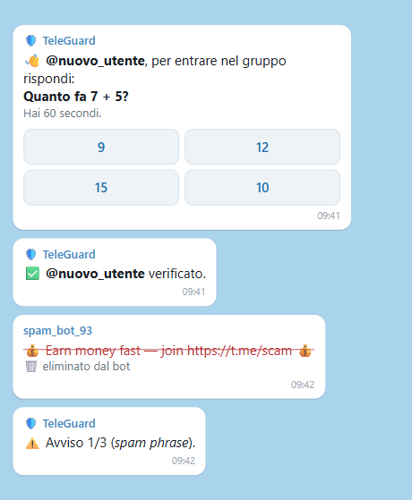
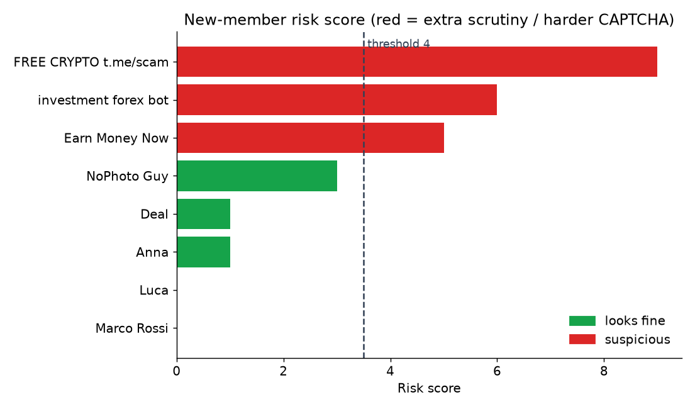
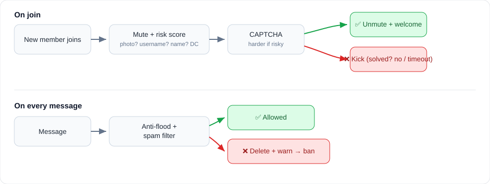

# TeleGuard


A moderation bot for Telegram groups. It blocks join bots with a CAPTCHA, gives every new member a quick
risk check, and keeps flooding and spam out, so you don't have to sit and watch the group all day.



*An example of the messages the bot sends.*

## What it does

When someone joins, the bot mutes them until they answer a small CAPTCHA. A real person taps it in a
second, a bot almost never does. Before showing the challenge it also takes a look at the account and
gives it a risk score, and if something seems off the challenge gets harder. What it looks at:

* no profile photo, or no username
* links, @handles or spam words in the name
* mixed alphabets, for example Cyrillic letters dressed up as Latin ones
* which datacenter (DC1 to DC5) the account sits in, read from the profile photo. This one is only a weak
  hint, so it's off by default.



On normal messages it runs an anti flood limit and a spam check: links or forwarded channel posts from
brand new users, known spam phrases, walls of mentions. Anything it catches gets deleted and the user
picks up a warning. Enough warnings and they're out.



Admins can also reply to a message with `/ban`, `/mute` or `/warn`.

## Setup

You need Python 3.10 or newer.

```bash
pip install -r requirements.txt
cp .env.example .env      # then fill it in
```

1. Create a bot with [@BotFather](https://t.me/BotFather) and copy the token into `TELEGRAM_BOT_TOKEN`.
2. Add the bot to your group as an admin, with the rights to ban users, delete messages and restrict
   members.
3. Turn off Group Privacy in BotFather, otherwise it can't read messages.

```bash
python -m teleguard
```

## Configuration

| Variable | Default | What it does |
|---|---|---|
| `TELEGRAM_BOT_TOKEN` | (none) | Bot token |
| `CAPTCHA_TIMEOUT` | `60` | Seconds to solve the join challenge |
| `FLOOD_MAX` / `FLOOD_SECONDS` | `5` / `5` | Messages per window before a mute |
| `WARN_LIMIT` | `3` | Warnings before an automatic ban |
| `RISK_THRESHOLD` | `4` | Risk score treated as suspicious |
| `SUSPICIOUS_DATACENTERS` | (none) | DCs to flag, e.g. `4 5`. Weak signal, off by default. |

## Tests

```bash
pip install pytest
pytest
```

The moderation logic (risk, spam, anti flood, datacenter decoding) is plain Python and has unit tests.
The two charts above come from that same code.

## Built with

Python and the library python-telegram-bot.

## License

[MIT](LICENSE)
